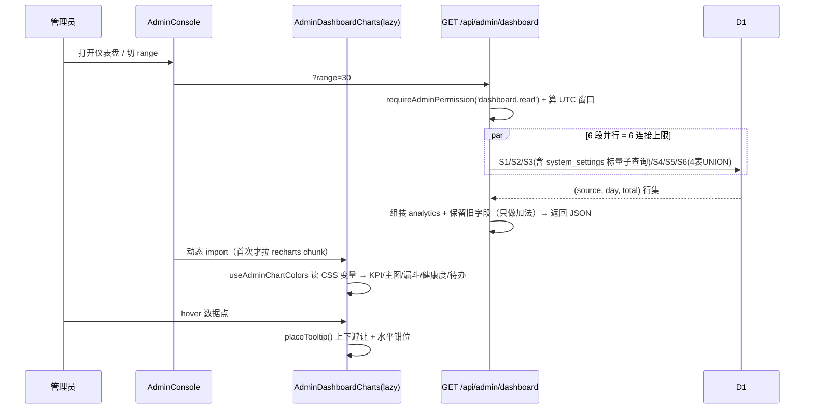

# 管理端数据仪表盘重做 + 视觉统一 · 架构设计 v1.0

> 架构师：高见远 ｜ 输入：`docs/admin-dashboard-prd.md` v1.0 ｜ 前端 `pindouwangge`（React 19.0.1/Vite 6/TS 5.8）｜ 后端 `stellabean-worker`（Workers+D1）

## 1. 待确认项结论（均有代码证据）
**1.1 `pattern.grid_finalized` 存在 → 漏斗第二步用它，但必须标"事件数"。**
`index.ts:459` 白名单声明该事件；`index.ts:501-505` 仅在 2xx 时写入 `user_activity_logs`（`actor_uid=NULL`、`entity_id=NULL`）；路由真实存在（`index.ts:289` → `gridPatterns.ts:631`）。
- **PRD 备选方案"用 `works` 状态表示完成"不成立**：`works.status ∈ {0=私有,1=公开,2=已删除}`（`0006_work_lifecycle.sql:5` 的 CHECK；`works.ts:117-131`）。`gridPatterns.ts:689` 的 `status=2` 是**保留配额淘汰旧作品**，不是完成。
- **它是"完成事件"不是"完成图纸数"**：`revision` 是入参（`gridPatterns.ts:636`），同一 work 每个 revision 可 finalize 一次 → 事件数 > 去重作品数；`entity_id` 恒 NULL 故**无法去重**。
- **推荐**：`completions = COUNT(*) WHERE event_type='pattern.grid_finalized'`，API 带 `completionsAreEvents:true`，文案写「完成事件（含修订）」（见 R3）。
**1.2 `storage_assets` 可算体积 → P2-16 可做**，零成本并入 S3 段。`0007_admin_console.sql:225-238`：`byte_size INTEGER NOT NULL CHECK(>=0)`、`resource_type`、`status IN ('active','deleted')`、`created_at` → `SUM(byte_size) WHERE status='active'` + 按 `created_at` 分天。
**1.3 代理活跃用户：三张表列名不一致，是最大易错点。**

| 表 | 用户列 | 时间列 | 证据 |
|---|---|---|---|
| `works` | **`user_id`** | `created_at` | `0001_normalize_schema.sql:43-56` |
| `community_posts` | **`author_uid`**（存在） | `published_at`/`withdrawn_at` | `0005_community_posts.sql:1-10` |
| `community_likes` / `community_favorites` | **`uid`** | `created_at` | `0005:12-19` / `0005:21-28` |

> `community_posts` **没有** `created_at`（现有代码已在 `admin.ts:207-209` 踩过此坑）。
**1.4 `system_settings` 可复用、不新增连接。** `0007:183` `setting_key TEXT PRIMARY KEY` → 标量子查询是 O(1) 主键查找；卡密段已用此模式（`admin.ts:219-220`）。

## 2. API 契约（只做加法，路径不变）
`GET /api/admin/dashboard?range=7|30`（默认 7，非法值回落 7）。旧字段 `overview/sections/todo/metrics/trends.days7/telemetry/warnings/meta` **原样保留**，新增 `analytics`：

```json
{ "analytics": {
  "range": 7, "todayStartUtc": "2025-11-11T00:00:00.000Z",
  "kpis": { "todayNewCreators": 12, "todayNewCreatorsPrevSameTime": 10, "todayNewCreatorsDeltaPct": 20.0,
    "publishConversion": { "numerator": 140, "denominator": 412, "rate": 0.3398 },
    "pendingTotal": 5, "pendingBreakdown": { "reviews": 3, "reports": 2 },
    "errorRate24hProxy": { "errors": 8, "requests": 640, "rate": 0.0123 } },
  "series": [{ "date": "2025-10-13", "newUsers": 3, "activeUsersProxy": 9, "works": 12,
    "posts": 4, "completions": 7, "errors": 0, "avgDurationMs": null }],
  "comparison": {
    "current":  { "newUsers": 55, "activeUsersProxy": 180, "works": 412, "completions": 268, "posts": 140, "errors": 21, "requests": 4200 },
    "previous": { "newUsers": 49, "activeUsersProxy": 165, "works": 366, "completions": 240, "posts": 145, "errors": 15, "requests": 3900 },
    "deltaPct": { "works": 12.57, "posts": -3.45, "errors": 40.0 } },
  "funnel": { "works": 412, "completions": 268, "posts": 140,
    "stepRate": { "toCompletion": 0.6505, "toPublish": 0.5224 },
    "overallRate": 0.3398, "completionsAreEvents": true },
  "quality": { "errorRateProxy": 0.0123, "errors": 8, "requests": 640, "avgDurationMs": 142,
    "maxDurationMs": 980, "durationSamples": 640,
    "errorCodesTop5": [{ "code": "HTTP_500", "count": 5 }], "unresolvedErrors": 3 } } }
```
**空值语义（硬约定）**：分母 ≤0 → `rate: null`（**不是 0/NaN/Infinity**）；无耗时样本 → `avgDurationMs: null`；环比前值 0 → `null`。前端一律渲染 `—`。`comparison` 另含 `from/to` 日期区间字符串。
**命名体现口径**：`activeUsersProxy` / `errorRate24hProxy` / `errorRateProxy` / `completionsAreEvents`。
**时区**：全 UTC。`todayStart = now - (now % 86400000)`（沿用 `admin.ts:178`）；昨日同刻 = `[yesterdayStart, yesterdayStart+elapsed)`，**SQL 内算完，前端不二次计算**。
### 2.1 D1 六连接合并方案：连接数不变，只换每段内的 UNION 分支
现 6 段已压满上限（`admin.ts:245-249` 注释 + `meta.requests:6`）。方案：**统一每段为 3 列形状 `(source, day, total)`**，`day=''` 表示窗口标量、非空表示按天序列 —— 标量与序列因此可同写进一条 `UNION ALL`，**一段 = 一条 prepared statement = 一条连接**。

| 段 | 域 | 分支 | 参数 | 主要分支 |
|---|---|---|---|---|
| S1 | 用户 | 6 | 5 | `total_users` `new_users_range` `active_vip` `today_new_users(_prev)` `d_new_users` |
| S2 | 内容 | 16 | 17 | `works_total` `posts_total` `today_new_creators(_prev)` `works_range(_prev)` `completions_range(_prev)` `posts_published_range(_prev)` `posts_withdrawn_range` `today_works` `today_posts` `d_works/_completions/_posts` |
| S3 | 运营（无参） | 8 | 0 | `pending_reviews` `pending_reports` `pending_reports_reviewing` `redeemed_codes` `available_codes` `low_stock_threshold`(标量子查询) `storage_assets` `storage_bytes` |
| S4 | 错误 | 6 | 5 | `errors_range` `errors_prev` `errors_24h` `unresolved_errors` `ec:…`(Top5) `d_errors` |
| S5 | 质量 | 7 | 7 | `requests_range(_prev)` `duration_samples` `avg_duration` `max_duration` `successful_actions_24h` `d_requests` `d_avg_duration` |
| S6 | 代理活跃 | 3 | 16 | `d_active_proxy`(4 表按天去重并集) `active_proxy_range` `active_proxy_prev` |

S1（其余同构，`?` 顺序即 `.bind()` 顺序）：

```sql
SELECT 'total_users' AS source, '' AS day, COUNT(*) AS total FROM users
UNION ALL SELECT 'new_users_range', '', COUNT(*) FROM users WHERE created_at >= ?
UNION ALL SELECT 'active_vip', '', COUNT(*) FROM users
  WHERE member_type > 0 AND (member_expire IS NULL OR member_expire > ?)
UNION ALL SELECT 'today_new_users', '', COUNT(*) FROM users WHERE created_at >= ?
UNION ALL SELECT 'today_new_users_prev', '', COUNT(*) FROM users WHERE created_at >= ? AND created_at < ?
UNION ALL SELECT 'd_new_users', strftime('%Y-%m-%d', created_at / 1000, 'unixepoch'), COUNT(*)
  FROM users WHERE created_at >= ? GROUP BY 2;
-- 参数：[rangeStart, now, todayStart, yesterdayStart, yesterdaySameMoment] = 5 个
```

S6（**注意三张表列名不同**）：

```sql
SELECT 'd_active_proxy' AS source, day, COUNT(*) AS total FROM (
  SELECT day, uid FROM (SELECT strftime('%Y-%m-%d', created_at/1000,'unixepoch') AS day, user_id AS uid    FROM works               WHERE created_at   >= ?)
  UNION SELECT day, uid FROM (SELECT strftime('%Y-%m-%d', created_at/1000,'unixepoch') AS day, author_uid AS uid FROM community_posts   WHERE published_at >= ?)
  UNION SELECT day, uid FROM (SELECT strftime('%Y-%m-%d', created_at/1000,'unixepoch') AS day, uid AS uid        FROM community_likes   WHERE created_at   >= ?)
  UNION SELECT day, uid FROM (SELECT strftime('%Y-%m-%d', created_at/1000,'unixepoch') AS day, uid AS uid        FROM community_favorites WHERE created_at >= ?)
) GROUP BY day;
-- UNION（非 UNION ALL）已在 (day,uid) 天然去重，再 GROUP BY day 得每日代理活跃数
```

**为何不超 6**：`Promise.all` 仍恰好 6 个元素；UNION 分支只增加单 statement 内算子，不增加 D1 连接；参数上限 17 ≪ SQLite 999。**加护栏**：单测断言 `Promise.all` 数组长度 `=== 6`，禁止第 7 段。

### 2.2 30 天扫描量与索引（现状不覆盖，必须加 migration）
现有索引**均不能**服务 `WHERE col >= ?`（全表扫描）：`users.created_at` 无索引（仅 `idx_users_email`）；`works.created_at` 只有 `idx_works_user_created(user_id, created_at)`（非最左前缀）；`community_posts.published_at` 只在 `idx_community_posts_public_cursor(withdrawn_at,…)` 内；`error_events.occurred_at` 仅在 `_fingerprint(fingerprint,…)`/`_open(resolved_at,…)` 内；`community_likes.created_at` 无；`community_favorites.created_at` 只在 `(uid,…)` 内。**唯一已可用**：`idx_user_activity_logs_created(occurred_at DESC, actor_uid)`。

→ 新增 `migrations/0022_dashboard_analytics_indexes.sql`（**纯加索引，不改数据**）：

```sql
CREATE INDEX IF NOT EXISTS idx_users_created_at             ON users(created_at);
CREATE INDEX IF NOT EXISTS idx_works_created_at_user        ON works(created_at, user_id);
CREATE INDEX IF NOT EXISTS idx_community_posts_published_at ON community_posts(published_at) WHERE withdrawn_at IS NULL;
CREATE INDEX IF NOT EXISTS idx_community_posts_withdrawn_at ON community_posts(withdrawn_at);
CREATE INDEX IF NOT EXISTS idx_user_activity_logs_event     ON user_activity_logs(event_type, occurred_at);
CREATE INDEX IF NOT EXISTS idx_error_events_occurred_at     ON error_events(occurred_at);
CREATE INDEX IF NOT EXISTS idx_community_likes_created_at   ON community_likes(created_at);
CREATE INDEX IF NOT EXISTS idx_community_favorites_created  ON community_favorites(created_at);
```

**评估**：加索引后每条序列查询退化为"近 N 天索引区间扫描"，扫描行数 = 窗口内新增行数，与表总量解耦。未加则全表扫描；`user_activity_logs` 每请求写 1 行（`index.ts:501`）增长最快，30 天查询必然劣化。**可逆**：回滚走 `DROP INDEX`（D1 migration 前向执行，用 `wrangler d1 execute --file`）。建索引对大表有一次性写放大，建议低峰执行。
## 3. 前端架构
### 3.1 依赖：**recharts@2.15.4（`-E` 精确固定，禁止 `^`）**
| 版本 | React 19 peer | 依赖图 | 实测 gzip（esbuild minify，react external） |
|---|---|---|---|
| **2.15.4** | `^19.0.0` ✅ | 无 redux/immer | **最小集 112.8KB**／完整所需集 118.8KB |
| 3.11.2 | `^19.0.0` ✅ | 拖入 `@reduxjs/toolkit`+`react-redux`+`immer`+`reselect`+`victory-vendor` | 最小集 **122.6KB** |

> **⚠️ PRD「gzip 增量 ≤60KB」实测不可达（约 2×）**：即使只 import `LineChart/Line/XAxis/YAxis/Tooltip/ResponsiveContainer` 也已 112.8KB —— d3(`victory-vendor`) 与 `react-smooth` 占大头，tree-shaking 收效有限。**建议重新基线**为"图表独立 chunk ≤125KB gzip + `AdminPage` 主 chunk 零增长"（当前实测 81,097B gzip / 271,596B raw）。真实收益来自**懒加载隔离**而非绝对值。若必须守 60KB，唯一出路是换库（`uPlot` ≈15KB gzip），需 PM 改 PRD §7。

**懒加载**：`AdminConsole.tsx` 内 `const AdminDashboardCharts = React.lazy(() => import('./dashboard/AdminDashboardCharts'))` + `<Suspense fallback={<DashboardSkeleton/>}>`。验证：

```bash
npm run build && gzip -c dist/assets/AdminDashboardCharts-*.js | wc -c   # 目标 ≤125*1024
gzip -c dist/assets/AdminPage-*.js | wc -c                             # 目标 ≤82000（不增长）
```

### 3.2 文件清单
| 文件 | 职责 |
|---|---|
| `dashboard/dashboardTypes.ts` | `AnalyticsData` 等类型 + 防御式解析器（沿用 `safeCount` 风格） |
| `dashboard/dashboardModel.ts` | 比率/环比/千分位格式化、空值→`—` |
| `dashboard/tooltipPlacement.ts` | **可复用避让纯函数**（单测） |
| `dashboard/useAdminChartColors.ts` | `getComputedStyle` 读 `--admin-series-1..5` |
| `dashboard/AdminDashboardCharts.tsx` | 懒加载边界，**唯一 import recharts 的文件** |
| `dashboard/KpiCards.tsx` `TrendMainChart.tsx` `FunnelPanel.tsx` `QualityPanel.tsx` `TodoBar.tsx` | A/B/C/D 区区块（纯展示不取数） |
| `admin.css` | 仅 token 层 + 图表/卡片样式（§3.5） |
| `AdminConsole.tsx` | **删除** `TrendChart`(143-186) 与 `MetricsPanel` 注册柱图；Dashboard 重写；带 `?range=` |
| `adminDashboardModel.ts` | **保留** `trendTooltipDate/trendTooltipValue`（复用）；**删除** `trendBarPixelHeights`/`registerTrendTotal` |

### 3.3 关键 Props 签名
```ts
export interface Rate { numerator: number; denominator: number; rate: number | null }
export interface Funnel { works: number; completions: number; posts: number;
  stepRate: { toCompletion: number|null; toPublish: number|null };
  overallRate: number|null; completionsAreEvents: boolean }
// tooltipPlacement.ts —— 纯函数，不依赖 DOM
export function placeTooltip(i: { pointX: number; pointY: number; plotWidth: number; plotHeight: number;
  tipWidth: number; tipHeight: number; gap?: number }): { x: number; y: number; placement: 'above'|'below' };
// 规则：pointY < plotHeight/2 → 'below'（点在上半部，提示放下方）；否则 'above'
// 水平：x = pointX - tipWidth/2 再钳位到 [0, plotWidth-tipWidth]；tipWidth > plotWidth 时 x = 0

KpiCards({kpis, range}) · TrendMainChart({series, range, colors}) · FunnelPanel({funnel})
QualityPanel({quality, series}) · TodoBar({todo, navigate}) · useAdminChartColors({readVar?})
```

### 3.4 颜色只走 CSS 变量
`useAdminChartColors` 挂载时 `getComputedStyle(document.querySelector('.admin-root')!)` 读 `--admin-series-1..5` 并 `useMemo` 缓存，注入 recharts 的 `stroke`/`fill`。**禁止** TSX 出现任何 `#` 字面量（源码正则 `#[0-9a-fA-F]{3,6}` 命中即断言失败）。`readVar` 可注入 → 单测无需真实 DOM。

### 3.5 视觉统一范围（只改 token 层，不逐页改结构）
`admin.css:1-20` 变量层：`--admin-faint` `#94a3b8`→`#5b6472`；`--admin-success` `#16a34a`→`#15803d`；`--admin-danger` `#dc2626`→`#b91c1c`；新增 `--admin-series-1..5`；圆角统一 8px（`AdminPermissionTree.tsx` 现存 10px）。先改变量，再逐页目检。
**受影响 15 模块（回归清单）**：dashboard、users、credits、codes、welfare、community、tagDictionary、bannedwords、brands、resources、operationLogs、runLogs、announcements、config、roles（源 `ADMIN_MENU_ITEMS`）。每页查：表头灰底、行高 36px、数字右对齐、按钮 32px、弹窗圆角 8px、无 10px 圆角、axe 对比度 0 error。

### 3.6 旧测试迁移（断言是"源码字符串匹配"，删组件必然失败）
| 测试 | 现状断言 | 处置 |
|---|---|---|
| `AdminDensity.test.ts:108-127` | `trendBarPixelHeights`/`registerTrendTotal`/`admin-register-*` | **删除**该 describe（组件已删） |
| `AdminDensity.test.ts:162,190-193` | `TrendChart` 唯一 tooltip、`trendTooltip*` | 改为断言新 `placeTooltip` 被调用 |
| `AdminVisualPolish.test.ts:64-75` | `.admin-register-bars/bar/track/empty` | **删除**（注册柱图移除，指标并入主图 `newUsers` 折线） |
| `adminDashboardModel.test.ts:65-83` | `trendTooltipDate/Value` | **保留不动**（函数复用） |
| 3 个 `*.browser.fixture.tsx` | mock 仅 `{overview,trends.days7,telemetry}` | 补 `analytics` 最小 mock；并回归"缺 `analytics` 也不崩" |

## 4. 调用流程


> 类型关系：`AnalyticsData` 聚合 `Kpis / SeriesPoint[] / Funnel / Quality`；`dashboardTypes.parseAnalytics()` 是唯一解析入口（失败返 `null`，不补造）；`useAdminChartColors` 与 `placeTooltip` 是 `TrendMainChart` 的两个纯依赖，均可脱离 recharts 单测。

## 5. 任务分解（5 个，按依赖排序）
| ID | 任务 | 改动文件 | 依赖 |
|---|---|---|---|
| **T1** | 后端 `analytics` 段 + 索引 migration | `migrations/0022_dashboard_analytics_indexes.sql`、`src/routes/admin.ts`（`getDashboard` 6 段重写）、`test/dashboard-analytics.test.ts` | — |
| **T2** | 前端数据层（类型/解析/格式化） | `dashboard/dashboardTypes.ts`、`dashboardModel.ts`、`dashboardModel.test.ts`、`adminDashboardModel.ts`（删 2 函数） | T1 |
| **T3** | 图表组件 + 懒加载 + 避让函数 | `AdminDashboardCharts.tsx`、`KpiCards.tsx`、`TrendMainChart.tsx`、`FunnelPanel.tsx`、`QualityPanel.tsx`、`TodoBar.tsx`、`useAdminChartColors.ts`、`tooltipPlacement.ts`(+test)、`package.json` | T2 |
| **T4** | 视觉 token 统一 | `admin.css`（token + `--admin-series-*`）、`AdminPermissionTree.tsx`（10px→8px）、`adminTokens.test.ts`（对比度/圆角断言） | T2 |
| **T5** | 集成 + 旧测试迁移 + 回归 | `AdminConsole.tsx`（删 `TrendChart`/`MetricsPanel`，接新区块，`?range=`）、`AdminDensity.test.ts`、`AdminVisualPolish.test.ts`、3 个 browser fixture | T3,T4 |

- **T1 验收**：`range=7/30` 均 200 且 `analytics` 四段齐全；分母 0 → `rate:null`；`meta.requests===6`；旧字段仍在；`Promise.all` 长度 `===6`；`npx wrangler d1 migrations apply --local` 正向成功。
- **T2 验收**：`npm run lint`；`npm test -- dashboardModel`（含 `rate(0,0)===null`、环比前值 0→`null`）。
- **T3 验收**：`placeTooltip` 三用例（上半→below／下半→above／左右钳位）；`grep -rn '#[0-9a-fA-F]\{6\}' dashboard/*.tsx` 无输出；`npm run build` 后 chunk 符合 §3.1。
- **T4 验收**：`npm test -- adminTokens`；axe 对比度 0 error；`grep -rn 'border-radius:10px' src/components/admin/` 无输出。
- **T5 验收**：`npm run verify`（`tsc --noEmit && vite build && vitest`）全绿；15 页目检通过；375px 无横向滚动。

**安装**：`cd D:\Build_Apps\pindouwangge && npm i -E recharts@2.15.4`

## 6. 共享约定 & 风险
**共享约定**：类型单源 `dashboard/dashboardTypes.ts`（`AdminConsole` 只 import 不另定义）；`xxxProxy` 后缀 = 代理口径；空值三分法 `null / 0 / —`；比率后端算、前端只格式化；`works.user_id` vs `community_posts.author_uid` vs `likes/favorites.uid` 不得混用。

| # | 风险 | 影响 | 应对 |
|---|---|---|---|
| **R1** | **recharts 实测 112.8–118.8KB gzip，60KB 预算达标不了** | P0-8 验收"不通过" | 重基线为"图表 chunk ≤125KB + AdminPage 零增长"（基线 81,097B 已实测）；或 PM 同意换 `uPlot` |
| **R2** | 30 天聚合加重 Worker CPU / D1 扫描 | 变慢或超时 | 0022 加索引消除全表扫描；S6 最重，必要时先砍 `active_proxy_prev`(P1) |
| **R3** | **漏斗非单调**：同一 work 多次 finalize，`completions` 可能 > `works` | 转化率 >100%，像 bug | 文案标「完成事件（含修订）」；`rate>1` 不钳位、渲染为"—（口径不可比）"；前端读 `completionsAreEvents` |
| **R4** | `pendingReports` 口径冲突：现有 `status='open'`（`admin.ts:213`、`adminReports.ts:103` 注明是产品决策），PRD 要 `IN ('open','reviewing')` | 改后与举报列表默认筛选不一致，P0-5 下钻计数对不上 | **本期保持 `'open'`**，另返 `pending_reports_reviewing` 供副行显示，需 PM 确认 |
| **R5** | 旧测试为源码字符串断言，删组件即红 | CI 失败 | T5 显式迁移（§3.6），不留并行实现 |

**部署顺序**：`0022 migration` → worker（只做加法，旧前端不受影响）→ 前端（读不到 `analytics` 显示 `—`，不崩）。**回滚**：worker 退版（`analytics` 暂无消费者）；前端退 chunk；索引 `DROP INDEX`（无数据变更）。
